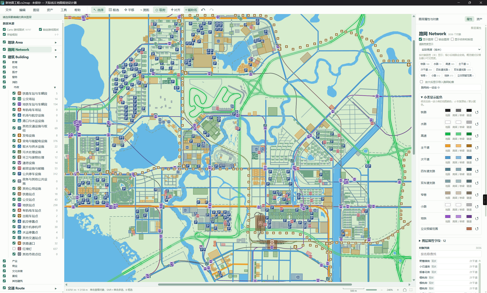

# 天际线Ⅱ地图规划设计器

<p align="center">
  
</p>


**先规划，再建设。**

一款面向《Cities: Skylines II》的独立地图规划工具。以底图和 Carto 导出数据为基础，在二维地图上设计片区、路网和功能区块，按真实尺寸摆放建筑资产。

提供 **Windows x64 绿色版**，使用系统 WebView2，日常编辑和保存可离线完成。

[下载最新版](https://github.com/AcrabTans/cs2-map-design/releases/latest) · [完整使用手册](docs/USER_GUIDE.md) · [问题反馈](https://github.com/AcrabTans/cs2-map-design/issues)

## 为什么做这个工具

在《Cities: Skylines II》里开建前，往往要先想清楚铁路怎么进城、港口和产业放在哪里、住宅区怎样分布，以及主要道路要预留多宽。游戏里边建边改，往往要拆掉已经铺好的路和建筑。

这款工具把地形、现状路网和建筑占地放到同一张地图上。你可以先定城市结构，再细化街坊和用地，最后把规划图带回游戏作建设参考。

## 快速开始

1. **启动软件。** 下载 Windows x64 绿色 ZIP，完整解压到可写文件夹，双击 `MapDesign.exe`。首次启动缺少 WebView2 时，按程序提示安装。
2. **导入现状或从空白开始。** 在游戏中用 [Carto](https://github.com/taipei-native/Carto) 导出地图，在软件里选「文件 → 导入 Carto 文件夹」，读取道路、建筑、区划、高程和水深。也可以从空白工程开始，在「图层 → 底图管理」导入图片。
3. **绘制、试排并保存。** 在左侧选择片区、功能区块或道路图层，在地图上绘制。双击已选道路或片区的边线可加节点。从资产库按尺寸摆放建筑，在工程界面用 `Ctrl+S` 保存。也可从「工具 → 规划工具」生成区域草案，暂存后编辑，再保存工作区或合并到工程。
4. **导出并在游戏中对照。** 打开需要的图层，从「文件 → 导出 PNG」导出完整地图。将 PNG 放入下方目录，在游戏中用 [Image Overlay](https://mods.paradoxplaza.com/mods/74539/Windows) 刷新文件列表并选中该图。按 `Ctrl+O` 切换显示，再按需调整位置、尺寸和透明度。

   ```text
   %USERPROFILE%\AppData\LocalLow\Colossal Order\Cities Skylines II\Overlays
   ```

   导出覆盖完整的 14.336 × 14.336 km 可玩区。地图范围一致时更容易对齐。更多设置见 [Image Overlay 作者说明](https://github.com/algernon-A/ImageOverlay/blob/master/README.md)。

## 主要功能



### 地形、底图与 Carto

- 导入 Carto 的七类 Shapefile 和配套属性，匹配道路中心线与轮廓、建筑轮廓与兴趣点。
- 读取 `Elevation.tif` 和 `Depth.tif`，显示高程、水体及陆水简图。可导入并切换多张正方形底图。
- 重导入同一地图时更新游戏现状，保留手绘规划。

### 分层编辑

| 图层 | 内容 |
| --- | --- |
| 地块 Area | 大片区、小片区、功能区块、游戏地块 |
| 路网 Network | 高速、主干道、次干道、双车道和四车道支路、窄巷、小路、铁路、地铁、水路和互通预留 |
| 建筑 Building | 住宅、商业、产业、教育、医疗、警务、消防、市政、体育和景观等 |
| 交通 Route | 公交、地铁、客运铁路、水上及航空线路 |
| 地形 Terrain | 底图、高程、水体、陆水简图 |
| 用地 Zoning | Carto 导入的游戏用地区划 |

各图层可单独显示、锁定和配色。绘图支持节点插入、整体移动、节点吸附、测距、500 m 参考网格及撤销和恢复。道路可按地面、高架、隧道设置样式。

### 建筑资产

内置 **21 个资产包、6280 项二维资产**，包括游戏本体、11 个 DLC 和 9 个官方地区包。建筑可按名称、用途或编号查找，并按实际占地和二维轮廓摆放、移动与旋转。属性面板可查看高度、占地及资产附带的容量数据。

支持导入 `.cs2assets` 或 JSON 二维资产包。桌面端可在「工具 → 资产提取」把符合条件的第三方 `.cok` 批量转换为 `.cs2assets`。 [内置资产说明](docs/BUILTIN_ASSETS.md)

### 区域规划与独立工作区

选择片区并设置用途面积比例、建筑限高和对外接点。草案以双车道支路连接街坊，用窄巷补短连接，较大的片区可用四车道支路集散。具备两端骨干路接入条件的大型商业或产业片区才考虑次干道。

预览显示路型、楼栋、组团高度、绿地、树木和用地分配。可以将草案暂存后手动编辑，也可保存为 `.cs2plan` 或单独导出规划图层。确认后可将选定内容合并到当前工程。

### 工程与导出

- 新建、打开、保存或另存为 `.cs2map` 工程，支持项目文件夹。
- 导出 **2048 / 4096 / 8192** 分辨率的整图 PNG。
- 导出七组 Shapefile 及配套文件，可选附带原始地形数据。也可单独导出手绘规划，再叠加到同一张地图的其他工程。

### 取名工具

为道路、片区和建筑等对象生成名称。提供 14 种地区风格、23 类对象和中英对照，可搜索词库。

## 问题反馈

> 反馈归反馈，修复随缘：我不一定有空修；有空修的时候，也得看看 GPT 龙娘的心情。欢迎提建议，但不承诺修复时间。

提交问题时，请附上程序和 Windows 版本、复现步骤、错误信息或截图。有最小复现工程时，先检查其中的本地路径和个人内容。 [GitHub Issues](https://github.com/AcrabTans/cs2-map-design/issues)

## 技术与运行方式

桌面端使用 Tauri 和 Windows 系统 WebView2，二维地图基于 SVG。打开、保存和导出使用系统文件对话框。日常绘制和规划生成可离线运行，前端也可单独构建为离线网页。

## 项目状态与第三方组件

- **全局规划目前不可用。** 区域规划仍适合试排和估算占地，接点、建筑入口、坡地和绿地连通性需在建设前核对。
- 规划图通过 Image Overlay 在游戏中作为参照，道路和建筑由玩家在游戏内建设。大型工程的编辑性能及第三方资产兼容性仍需逐步验证。
- 项目按 MIT 许可证发布。发布包附第三方许可索引和 SHA-256 校验文件，各第三方组件适用各自的许可证。 [项目许可证](LICENSE) · [第三方组件说明](THIRD_PARTY_NOTICES.md)

## 源码开发

在 `source` 目录使用 Node.js 22+ 运行测试并构建前端。Windows 桌面版另需 Rust 和 Windows C++ 编译工具链。

```powershell
npm test
npm run build
cargo build --locked --release --manifest-path src-tauri/Cargo.toml
```

前端在 `source/src`，Tauri 宿主在 `source/src-tauri`，网页产物在 `source/dist`。独立提取器源码在 `tools/资产提取器`。 [构建与打包说明](source/README.md)
